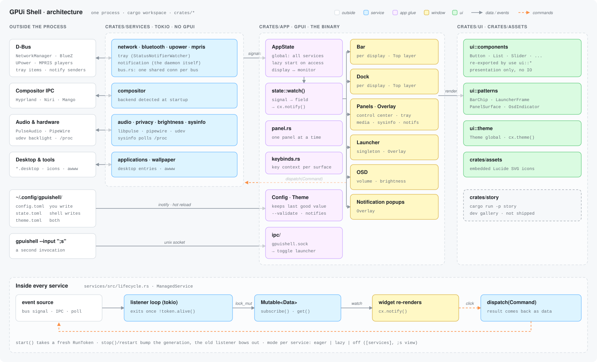

# Contributing to GPUi Shell

Thanks for wanting to help! Bug reports, docs fixes, new bar modules and big
refactors are all welcome. The [roadmap](ROADMAP.md) lists what we're working
toward for 1.0 and where help is most needed.

Developer docs live in [`docs/src/content/docs/developer/`](docs/src/content/docs/developer/):

- **[Development setup](docs/src/content/docs/developer/setup.md)**:
  build, run, test, profile, and code conventions.
- **[Architecture](docs/src/content/docs/developer/architecture.md)**:
  how the crates, services and windows fit together. Read it before your
  first non-trivial change.

[](docs/public/architecture.svg)

The quick version:

```bash
nix develop
cargo run
```

## Finding something to work on

- Issues labelled
  [`good first issue`](https://github.com/andre-brandao/gpui-shell/labels/good%20first%20issue)
  are small and need little context.
- [`help wanted`](https://github.com/andre-brandao/gpui-shell/labels/help%20wanted)
  issues are bigger but nobody is on them yet.
- `design` issues need a discussion first. Sketch your approach in the issue
  before writing code.

For anything not tracked yet, open an issue first unless it's a small fix.

## Before opening a PR

CI runs these on every PR, so run them locally first:

```bash
cargo fmt --all
cargo clippy --workspace --all-targets -- -D warnings
cargo test --workspace
```

`nix build` also runs in CI. If you changed dependencies or the Nix files,
run it locally too.

Config lives in `config.rs` files with a doc comment on every field. You
don't need to update the reference docs by hand: the Claude Docs workflow
(`.github/workflows/claude-docs.yml`) syncs `docs/src/content/docs/reference/`
from changed `config.rs` files when `dev` merges into `main`.

For UI changes, include a screenshot or short recording in the PR. If you
add or remove a service or a window, update the architecture diagram
(`docs/public/architecture.svg`) in the same PR.

## Pull requests

- Branch from `dev` and target `dev` with your PR. `main` only gets release
  merges.
- Keep PRs focused, one feature or fix each. Several small PRs are easier to
  review than one large one.
- Use [Conventional Commits](https://www.conventionalcommits.org) for commit
  messages: `feat:`, `fix:`, `refactor:`, `perf:`, `docs:`, `chore:`. Describe
  what changed and why, e.g. `fix: size the bar from the compositor's scale`.
- Link the issue the PR closes (`Closes #123`).
- AI-assisted contributions are fine, but you are responsible for
  understanding and testing what you submit.

## Reporting bugs

Use the [bug report template](https://github.com/andre-brandao/gpui-shell/issues/new/choose).
The most useful details are your compositor and its version, the output of
`RUST_LOG=debug gpuishell` around the problem, and the relevant parts of
your `config.toml`.
